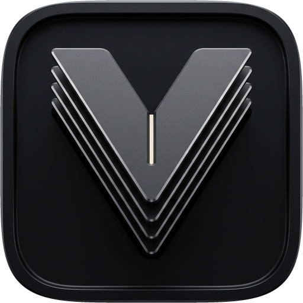
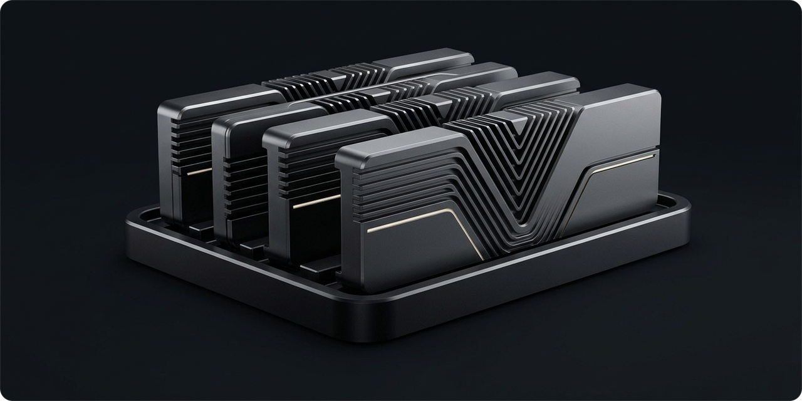
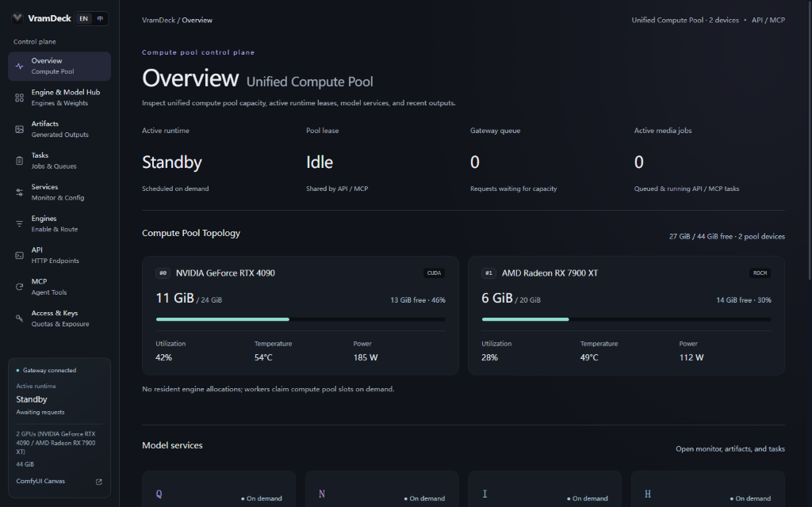
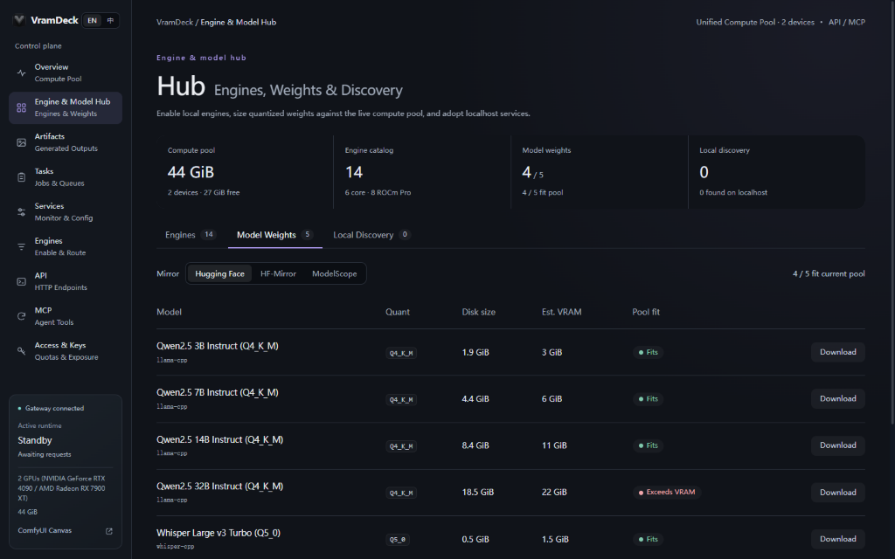
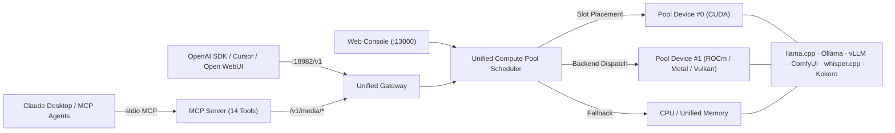

<div align="center">
  
  <h1>VramDeck</h1>
  <p><strong>Local AI gateway and unified compute pool scheduler — run LLMs, image, video, and audio together on 1–4 GPUs without OOM crashes.</strong></p>
  <p>
    <a href="README.md">English</a> · <a href="README.zh-CN.md">简体中文</a> · <a href="docs/README.md">Documentation</a> · <a href="CONTRIBUTING.md">Contributing</a>
  </p>
  <p>
    <a href="https://github.com/Aoike123/VramDeck/actions/workflows/ci.yml"></a>
    = 22.19" />
    
    <a href="LICENSE"></a>
  </p>
  <br />
  
</div>

---

Running an LLM in Ollama, generating images in ComfyUI, and transcribing audio with Whisper on the same machine usually ends one of two ways: `CUDA out of memory`, or manually stopping and restarting Docker containers whenever you switch workloads.

**VramDeck** sits in front of your engines as a **single unified local compute pool** — one **VRAM-aware coordinator**, one **OpenAI-compatible API gateway (`:18982`)**, one **MCP media server**, and one **Web Console (`:13000`)**. Instead of acting like a distributed cluster or leaving cards siloed, it treats every accelerator and host memory pool on your machine (`CUDA`, `ROCm`, `Metal`, `Vulkan`, `CPU`) as one managed local resource pool: co-locating compatible engines when capacity allows and draining active leases gracefully before swapping heavy models.

## Built for Real Local Setups

| Your Machine | Without VramDeck | With VramDeck |
| --- | --- | --- |
| **Single GPU (8–24 GB)** | Leaving an LLM loaded causes ComfyUI or Whisper to OOM-crash. | Schedules compatible models together inside the pool and drains/replaces heavy ones cleanly when queued tasks need room. |
| **2–4 Heterogeneous GPUs** | Pinning `CUDA_VISIBLE_DEVICES` / `HIP_VISIBLE_DEVICES` by hand leaves half your VRAM stranded. | Aggregates CUDA, ROCm, Metal, Vulkan, and CPU devices into one unified compute pool with live slot tracking and best-fit placement. |
| **Apple Silicon & Laptops** | Different endpoints per app (`:11434`, `:18080`, `:18188`) and scattered weights. | Unified `/v1/*` gateway (`:18982`), automatic Metal/CPU fallback, and Hub pool-fit sizing (`Fits` / `Tight` / `Exceeds VRAM`). |

## Live Console (`:13000`)

<p align="center">
  
  <br />
  <sub><strong>Overview &amp; Compute Pool Topology</strong> — Live pool KPIs, segmented per-device VRAM bars, 3-column hardware telemetry (<code>CUDA</code> / <code>ROCm</code>), and on-demand model services.</sub>
</p>

<p align="center">
  
  <br />
  <sub><strong>Engine &amp; Model Hub</strong> — Inspect pool capacity, toggle core or <code>ROCm Pro</code> engines, pull quantized weights from Hugging Face, HF-Mirror, or ModelScope with live fit status (<code>Fits</code> / <code>Exceeds VRAM</code>), or adopt localhost daemons.</sub>
</p>

## How VramDeck Compares

| Capability | **VramDeck** | Ollama | LM Studio / vLLM | Manual Docker / Scripts |
| --- | --- | --- | --- | --- |
| **Single unified compute pool (LLM + Image + Video + Audio)** | Yes | LLM only | LLM / VLM focused | Fragile glue scripts |
| **Cross-engine best-fit VRAM packing** | Yes | Per-runner only | Single engine | Manual env vars |
| **Idle-drain eviction (zero mid-request kills)** | Yes | Basic TTL | Manual unload | `docker stop` kills jobs |
| **Mixed vendor GPUs (NVIDIA + AMD + Apple)** | Yes | Separate binaries | Separate servers | Manual port juggling |
| **Adopt existing Ollama / ComfyUI / llama.cpp** | Yes | — | Imports GGUF only | N/A |
| **Single OpenAI Gateway + MCP Media Server** | Yes (`:18982` + stdio MCP) | Chat API only | OpenAI API only | Separate per tool |

## How It Works



1. **Discover hardware into one pool**: On startup, VramDeck detects NVIDIA (`nvidia-smi`), AMD (`rocm-smi`), Apple Silicon (`system_profiler` / Metal), Vulkan, and host CPU resources into a single compute pool inventory.
2. **Schedule by live VRAM slots**: Before launching an engine, the coordinator reserves memory inside the unified pool (`CUDA`, `ROCm`, `Metal`, `Vulkan`, or `CPU`). Active requests finish draining cleanly before eviction.
3. **Adopt instead of replacing**: Already running Ollama on `:11434` or ComfyUI on `:18188`? Scan and adopt them from the Hub (`vramdeck hub scan`) while routing everything through `:18982`.

## Quickstart

### Prerequisites

- **Node.js `>= 22.19`** (plus `npm`)
- At least one inference engine installed locally (`llama.cpp`, `Ollama`, `vLLM`, `ComfyUI`, `whisper.cpp`, or `Kokoro`)

### 1. Clone and install

```bash
git clone https://github.com/Aoike123/VramDeck.git
cd VramDeck
npm --prefix platforms/workbench install
```

> Optional: link `vramdeck` globally with `npm --prefix platforms/workbench link`, or run any command via `node platforms/workbench/cli.mjs <cmd>` (or `./lab <cmd>` on Linux/macOS).

### 2. Build the Console UI and start VramDeck

```bash
WORKBENCH_NEXT_DIST=.next-workbench npm --prefix platforms/workbench run build
node platforms/workbench/cli.mjs start
```

Open **`http://127.0.0.1:13000`** in your browser (`EN` / `中文` toggle in the sidebar).

### 3. Inspect GPUs, scan engines, and verify health

```bash
node platforms/workbench/cli.mjs devices --json
node platforms/workbench/cli.mjs hub scan
node platforms/workbench/cli.mjs status
```

## Connect Your Tools in 30 Seconds

### OpenAI SDK, Cursor, Open WebUI, or Chatbox

Point any OpenAI-compatible client to `http://127.0.0.1:18982/v1`:

```python
from openai import OpenAI

client = OpenAI(
    base_url="http://127.0.0.1:18982/v1",
    api_key="local",
)

resp = client.chat.completions.create(
    model="llama-cpp",
    messages=[{"role": "user", "content": "Explain shared VRAM scheduling in 3 bullets."}],
)
print(resp.choices[0].message.content)
```

### Claude Desktop / MCP Clients (14 Built-In Media & Tool Calls)

Initialize local MCP credentials once while the gateway is running:

```bash
node platforms/mcp/cli.mjs setup
node platforms/mcp/cli.mjs check
```

Add `vramdeck-media` to your MCP client config:

```json
{
  "mcpServers": {
    "vramdeck-media": {
      "command": "node",
      "args": ["<path-to-VramDeck>/platforms/mcp/cli.mjs", "stdio"]
    }
  }
}
```

### Pull Quantized Weights via Mirror & Auto-Size Check

```bash
node platforms/workbench/cli.mjs hub pull qwen2.5-7b-instruct-q4_k_m --mirror hf-mirror
```

Curated mirror backends support **`huggingface`**, **`hf-mirror`**, and **`modelscope`**, and every catalog weight checks fit (`fits` / `tight` / `too_large`) against your live GPU pool before downloading.

## Built-in Engines

All six cross-platform engine packages live under `engines/*/*/engine.json` (`default_enabled: false` until you adopt, install, or enable them):

| Engine | Modality | Driver | Default Port | Supported Backends | Default Est. VRAM | Concurrency |
| --- | --- | --- | --- | --- | --- | --- |
| [`llama-cpp`](engines/llm/llama-cpp/engine.json) | LLM / Chat (GGUF) | `process` | `18080` | CUDA, ROCm, Metal, Vulkan, CPU | `4,096 MB` | `2` |
| [`ollama`](engines/llm/ollama/engine.json) | LLM / Chat | `external` | `11434` | CUDA, ROCm, Metal, CPU | `4,096 MB` | `2` |
| [`vllm`](engines/llm/vllm/engine.json) | High-Throughput LLM | `docker` | `18000` | CUDA, ROCm | `8,192 MB` | `4` |
| [`comfyui`](engines/image/comfyui/engine.json) | Image & Video | `external` | `18188` | CUDA, ROCm, Metal, Vulkan, CPU | `6,144 MB` | `1` |
| [`whisper-cpp`](engines/audio/whisper-cpp/engine.json) | Speech-to-Text | `process` | `18081` | CUDA, ROCm, Metal, Vulkan, CPU | `2,048 MB` | `2` |
| [`kokoro`](engines/audio/kokoro/engine.json) | Text-to-Speech | `process` | `18082` | CUDA, ROCm, Metal, CPU | `2,048 MB` | `2` |

Adding your own engine takes one folder (`engine.json` + `adapter.mjs` validated against `@vramdeck/engine-sdk`). See [Add an Engine](docs/guide/ADD_ENGINE.md).

## CLI Cheat Sheet

Run with `vramdeck <command>` (if linked) or `node platforms/workbench/cli.mjs <command>`:

| Command | Purpose |
| --- | --- |
| `start [--headless]` / `stop` / `restart` | Start, stop, or restart the VramDeck server & scheduler daemon |
| `status` / `logs [--lines N]` | Show daemon state, gateway health, and trailing logs |
| `devices [--json]` | Inspect detected CUDA, ROCm, Metal, Vulkan, and CPU memory |
| `scheduler status \| switch <model> \| run <model>` | Inspect leases or schedule/start an engine package |
| `engine list \| status [pkg] \| enable <pkg> \| disable <pkg>` | List or toggle engine packages without hand-editing JSON |
| `hub scan \| install \| pull` | Scan local ports, install runtimes, or download mirror weights |
| `service install \| uninstall \| status` | Register or inspect background user service definitions |

## Documentation

| Topic | Guide |
| --- | --- |
| Full Docs Index | [docs/README.md](docs/README.md) |
| Architecture & Best-Fit Pool | [docs/design/ARCHITECTURE.md](docs/design/ARCHITECTURE.md) |
| Multi-GPU & Engine Scheduling | [docs/design/MODEL_SCHEDULING.md](docs/design/MODEL_SCHEDULING.md) |
| Engine Packages & Manifest Spec | [docs/design/ENGINES.md](docs/design/ENGINES.md) |
| OpenAI Gateway, Hub & Lease API | [docs/api/CURRENT_API.md](docs/api/CURRENT_API.md) |
| MCP Media Server & Tools | [docs/api/MEDIA_MCP.md](docs/api/MEDIA_MCP.md) |
| Adding a Custom Engine | [docs/guide/ADD_ENGINE.md](docs/guide/ADD_ENGINE.md) |

---

<details>
<summary><strong>Optional ROCm Pro Pack (<code>rocm-pro</code>) &amp; Legacy <code>./lab</code> / <code>llm-backend</code> Compatibility</strong></summary>

- **ROCm Pro Pack (`rocm-pro`)**: Ships 8 specialized AMD ROCm packages under `engines/` (`pation-model-qwen38-27b-w3a4`, `pation-model-qwen38-27b-mxfp4`, `pation-model-qwen-image-21`, `anima`, `pation-model-minimax-h3`, `fish-drama3`, `bs-roformer`, `qwen3-asr`) for single- and multi-GPU RDNA4 / workstation deployments. Disabled by default so clean installations stay hardware-agnostic.
- **`./lab` Wrapper &amp; `llm-backend` Compatibility**: Existing Linux scripts using `./lab` continue to delegate to the unified control plane, and legacy environment/migration references from the earlier `llm-backend` workbench remain backwards-compatible for existing deployments. See [Operations Guide](docs/guide/OPERATIONS.md) and [Services &amp; Storage](docs/guide/SERVICES.md).

</details>

## License

Released under the [MIT License](LICENSE). Contributions are welcome — see [CONTRIBUTING.md](CONTRIBUTING.md).
