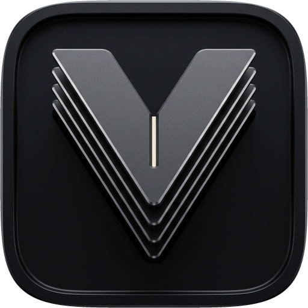
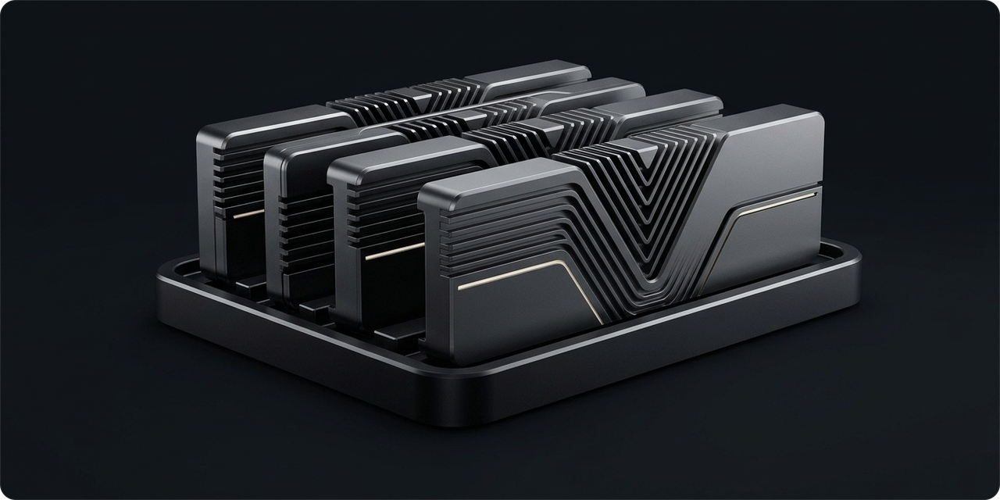
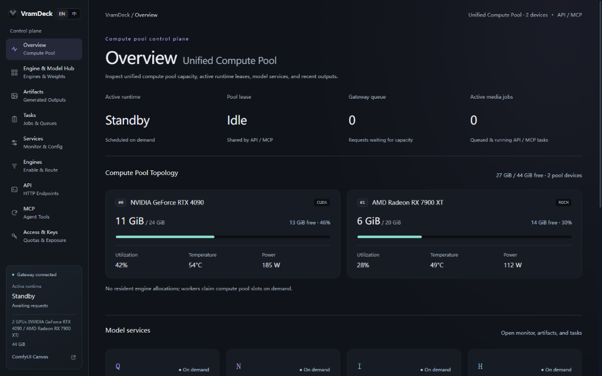
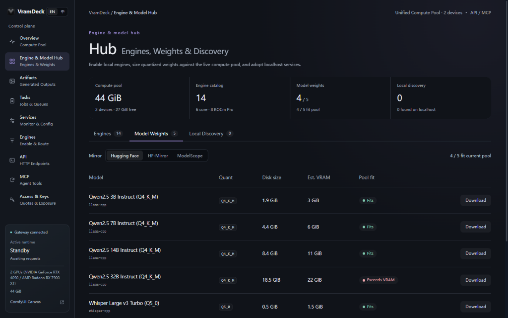
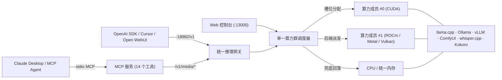

<div align="center">
  
  <h1>VramDeck</h1>
  <p><strong>面向本地 AI 工作站的统一网关与单一算力群算力调度器 —— 让 LLM、图像、视频与音频模型同机共享调度不 OOM。</strong></p>
  <p>
    <a href="README.md">English</a> · <a href="README.zh-CN.md">简体中文</a> · <a href="docs/README.md">文档中心</a> · <a href="CONTRIBUTING.md">参与贡献</a>
  </p>
  <p>
    <a href="https://github.com/Aoike123/VramDeck/actions/workflows/ci.yml"></a>
    = 22.19" />
    
    <a href="LICENSE"></a>
  </p>
  <br />
  
</div>

---

在同一台机器上同时跑 Ollama 对话、ComfyUI 生图和 Whisper 语音识别，往往只会出现两种结局：要么直接 `CUDA out of memory`，要么每次切换工作流都得手动 `kill` 进程或启停容器。

**VramDeck** 将整台主机上的加速卡与主机内存收敛为一个**单一本地算力群**：对外仅暴露一个 **OpenAI 兼容统一网关（`:18982`）**、一个 **MCP 媒体服务** 与双语 **Web 控制台（`:13000`）**。它不是多机集群调度器，也不要求你给每张卡单独配服务；而是由统一的显存协调器追踪全局显存槽位，在余量充裕时让兼容引擎同池共驻，在重型模型入池时先等待在途请求安全排空再优雅替换，让 `CUDA` / `ROCm` / `Metal` / `Vulkan` / `CPU` 协同成一个单一算力群。

## 为真实本地工作站设计

| 你的硬件环境 | 没有 VramDeck 时 | 使用 VramDeck 后 |
| --- | --- | --- |
| **单卡主机（8–24 GB）** | 聊天模型常驻占用显存，启动生图或语音识别立刻 OOM 崩溃。 | 在算力池内自动协调轻量引擎共驻；重负载需要显存时安全排空旧租约再拉起目标引擎。 |
| **2–4 卡同构或异构混插** | 手工指定 `CUDA_VISIBLE_DEVICES` / `HIP_VISIBLE_DEVICES`，显存碎片大量闲置。 | 收敛为单一本地算力群，由显存调度器实时追踪 CUDA / ROCm / Metal / Vulkan / CPU 槽位与亲和并统一派发。 |
| **Apple Silicon 与笔记本** | 每个工具端口各异（`:11434`、`:18080`、`:18188`），权重散落难管。 | 统一 `/v1/*` 入口（`:18982`），支持 Metal / CPU 兜底与 Hub 池容匹配（`显存适配` / `余量较紧` / `显存不足`）。 |

## 实时 Web 控制台（`:13000`）

<p align="center">
  
  <br />
  <sub><strong>总览与算力群拓扑</strong> —— 实时呈现统一算力池指标、分段显存槽位条、三列硬件遥测（<code>CUDA</code> / <code>ROCm</code>）与按需模型服务。</sub>
</p>

<p align="center">
  
  <br />
  <sub><strong>引擎与模型中心（Hub）</strong> —— 基于算力池余量筛选核心引擎与 <code>ROCm Pro</code> 套件，通过 Hugging Face / HF-Mirror / ModelScope 镜像拉取量化权重并自动计算池容适配（<code>显存适配</code> / <code>显存不足</code>），支持扫描接管本机服务与挂载本地目录。</sub>
</p>

## 能力对比

| 核心能力 | **VramDeck** | Ollama | LM Studio / vLLM | 手工 Docker / 脚本 |
| --- | --- | --- | --- | --- |
| **单一算力群统一调度（LLM + 图像 + 视频 + 语音）** | 支持 | 仅 LLM | 偏重 LLM / VLM | 依赖脆弱胶水脚本 |
| **跨引擎显存装箱与同池共驻** | 支持 | 仅单引擎管理 | 单引擎为主 | 需手工计算分配 |
| **安全排空置换（不强杀在途请求）** | 支持 | 固定超期卸载 | 需手动卸载 | `docker stop` 中断任务 |
| **NVIDIA + AMD + Apple 异构整合进单一池** | 支持 | 分离实例 | 分离启动 | 手动绑定端口与环境变量 |
| **扫描并接管现有 Ollama / ComfyUI** | 支持 | — | 仅导入本地 GGUF | 不适用 |
| **OpenAI 统一网关 + MCP 媒体服务** | 支持（`:18982` + stdio MCP） | 仅对话接口 | 仅 OpenAI 接口 | 需分别接入 |

## 工作原理



1. **硬件聚合为单一算力群**：启动时自动探测 NVIDIA（`nvidia-smi`）、AMD（`rocm-smi`）、Apple Silicon（Metal）、Vulkan 与主机内存，纳入统一算力群清单。
2. **基于实时显存槽位按需调度**：拉起引擎前先在单一算力群中预留显存租约（`CUDA`、`ROCm`、`Metal`、`Vulkan` 或 `CPU`）；空间紧张时等待当前在途任务安全排空后再置换。
3. **接管而非强迫重装**：本机已经跑着 `:11434` 的 Ollama 或 `:18188` 的 ComfyUI？通过 `vramdeck hub scan` 直接扫入算力群并统一收敛到 `:18982`。

## 快速上手

### 运行前置

- **Node.js `>= 22.19`**（含 `npm`）
- 本机至少已安装一个常用本地引擎（如 `llama.cpp`、`Ollama`、`vLLM`、`ComfyUI`、`whisper.cpp` 或 `Kokoro`）

### 1. 克隆并安装依赖

```bash
git clone https://github.com/Aoike123/VramDeck.git
cd VramDeck
npm --prefix platforms/workbench install
```

> 可选：执行 `npm --prefix platforms/workbench link` 后可直接使用全局命令 `vramdeck`，或随时使用 `node platforms/workbench/cli.mjs <子命令>`（Linux/macOS 亦可用 `./lab <子命令>`）。

### 2. 构建控制台并启动

```bash
WORKBENCH_NEXT_DIST=.next-workbench npm --prefix platforms/workbench run build
node platforms/workbench/cli.mjs start
```

打开浏览器访问 **`http://127.0.0.1:13000`**（侧边栏支持 `EN` / `中文` 一键切换）。

### 3. 查看多卡拓扑与运行状态

```bash
node platforms/workbench/cli.mjs devices --json
node platforms/workbench/cli.mjs hub scan
node platforms/workbench/cli.mjs status
```

## 30 秒接入现有客户端

### OpenAI SDK、Cursor、Open WebUI 或 Chatbox

将任意 OpenAI 兼容客户端的 Base URL 设为 `http://127.0.0.1:18982/v1`：

```python
from openai import OpenAI

client = OpenAI(
    base_url="http://127.0.0.1:18982/v1",
    api_key="local",
)

resp = client.chat.completions.create(
    model="llama-cpp",
    messages=[{"role": "user", "content": "用三点概括共享显存池调度的优势。"}],
)
print(resp.choices[0].message.content)
```

### Claude Desktop / MCP 客户端（内置 14 个媒体与任务工具）

保持网关运行时，初始化一次本地 MCP 凭据并检查连通性：

```bash
node platforms/mcp/cli.mjs setup
node platforms/mcp/cli.mjs check
```

在 MCP 客户端配置中添加 `vramdeck-media`：

```json
{
  "mcpServers": {
    "vramdeck-media": {
      "command": "node",
      "args": ["<path-to-VramDeck>/platforms/mcp/cli.mjs", "stdio"]
    }
  }
}
```

### 多镜像权重拉取与自动显存匹配

```bash
node platforms/workbench/cli.mjs hub pull qwen2.5-7b-instruct-q4_k_m --mirror hf-mirror
```

内置支持 **`huggingface`**、**`hf-mirror`** 与 **`modelscope`** 镜像源，下载前会根据当前 GPU 池空闲显存自动计算适配状态（`fits` / `tight` / `too_large`）。

## 内置跨平台引擎包

6 个主流跨平台引擎声明位于 `engines/*/*/engine.json`（默认 `default_enabled: false`，按需接管或启用）：

| 引擎包 | 能力 | 驱动模式 | 默认端口 | 支持后端 | 默认估算显存 | 默认并发 |
| --- | --- | --- | --- | --- | --- | --- |
| [`llama-cpp`](engines/llm/llama-cpp/engine.json) | 文本对话 (GGUF) | `process` | `18080` | CUDA, ROCm, Metal, Vulkan, CPU | `4,096 MB` | `2` |
| [`ollama`](engines/llm/ollama/engine.json) | 文本对话 | `external` | `11434` | CUDA, ROCm, Metal, CPU | `4,096 MB` | `2` |
| [`vllm`](engines/llm/vllm/engine.json) | 高吞吐 LLM | `docker` | `18000` | CUDA, ROCm | `8,192 MB` | `4` |
| [`comfyui`](engines/image/comfyui/engine.json) | 图像与视频工作流 | `external` | `18188` | CUDA, ROCm, Metal, Vulkan, CPU | `6,144 MB` | `1` |
| [`whisper-cpp`](engines/audio/whisper-cpp/engine.json) | 语音转文字 | `process` | `18081` | CUDA, ROCm, Metal, Vulkan, CPU | `2,048 MB` | `2` |
| [`kokoro`](engines/audio/kokoro/engine.json) | 文本转语音 | `process` | `18082` | CUDA, ROCm, Metal, CPU | `2,048 MB` | `2` |

接入自定义引擎只需新增一个包目录（`engine.json` + `adapter.mjs`，遵循 `@vramdeck/engine-sdk` 接口）。详见 [接入新引擎](docs/guide/ADD_ENGINE.md)。

## CLI 速查表

可通过 `vramdeck <子命令>`（链接后）或 `node platforms/workbench/cli.mjs <子命令>` 调用：

| 命令 | 作用 |
| --- | --- |
| `start [--headless]` / `stop` / `restart` | 启动、停止或重启 VramDeck 控制面与调度守护进程 |
| `status` / `logs [--lines N]` | 查看守护进程、网关健康状态与近期日志 |
| `devices [--json]` | 探测并输出当前 CUDA、ROCm、Metal、Vulkan 与 CPU 内存拓扑 |
| `scheduler status \| switch <model> \| run <model>` | 查询显存租约，或手动切换/启动指定引擎包 |
| `engine list \| status [pkg] \| enable <pkg> \| disable <pkg>` | 列出并管理引擎包的启用与停用状态 |
| `hub scan \| install \| pull` | 扫描本机运行中的外部服务、安装运行时或镜像拉取模型权重 |
| `service install \| uninstall \| status` | 安装、卸载或查看系统用户级后台服务单元 |

## 文档导航

| 主题 | 文档 |
| --- | --- |
| 完整文档目录 | [docs/README.md](docs/README.md) |
| 整体架构与显存池设计 | [docs/design/ARCHITECTURE.md](docs/design/ARCHITECTURE.md) |
| 多卡引擎调度策略 | [docs/design/MODEL_SCHEDULING.md](docs/design/MODEL_SCHEDULING.md) |
| 引擎包目录与清单规范 | [docs/design/ENGINES.md](docs/design/ENGINES.md) |
| OpenAI 网关、Hub 与调度 API | [docs/api/CURRENT_API.md](docs/api/CURRENT_API.md) |
| MCP 媒体服务与工具规范 | [docs/api/MEDIA_MCP.md](docs/api/MEDIA_MCP.md) |
| 接入自定义引擎 | [docs/guide/ADD_ENGINE.md](docs/guide/ADD_ENGINE.md) |

---

<details>
<summary><strong>可选 ROCm Pro 套件（<code>rocm-pro</code>）与早期 <code>./lab</code> / <code>llm-backend</code> 兼容说明</strong></summary>

- **ROCm Pro 套件（`rocm-pro`）**：`engines/` 下还随附了 8 个 AMD ROCm 深度优化引擎包（`pation-model-qwen38-27b-w3a4`、`pation-model-qwen38-27b-mxfp4`、`pation-model-qwen-image-21`、`anima`、`pation-model-minimax-h3`、`fish-drama3`、`bs-roformer`、`qwen3-asr`）。这些包默认处于停用状态，确保全新安装开箱保持硬件无关。
- **`./lab` 包装脚本与 `llm-backend` 历史兼容**：早期 Linux 部署中使用的 `./lab` 命令及 `llm-backend` 迁移路径仍保留向后兼容。详情参阅 [运维文档](docs/guide/OPERATIONS.md) 与 [服务与目录布局](docs/guide/SERVICES.md)。

</details>

## 开源协议

基于 [MIT License](LICENSE) 开源，欢迎提交 Issue 与 PR —— 参阅 [CONTRIBUTING.md](CONTRIBUTING.md)。
