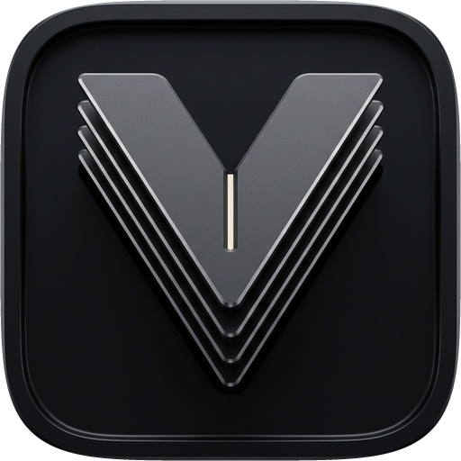

  
  <h1>VramDeck Documentation</h1>
  
Unified local compute pool scheduling, OpenAI gateway, MCP media server, and Web Console reference.

  
<a href="../README.md">English README</a> · <a href="../README.zh-CN.md">简体中文 README</a> · <a href="../CONTRIBUTING.md">Contributing</a>

---

VramDeck turns 1–4 local accelerators (`CUDA`, `ROCm`, `Metal`, `Vulkan`) and CPU memory on one machine into a **single unified local compute pool** behind `:18982` (API), `:13000` (Web Console), and stdio MCP.

## Guides

| Document | Focus |
| --- | --- |
| [Operations Guide](guide/OPERATIONS.md) | Starting, stopping, inspecting pool capacity, hub mirror downloads, and service troubleshooting |
| [Services & Layout](guide/SERVICES.md) | Single-process control plane ports, repository structure, and optional background services |
| [Development Guide](guide/DEVELOPMENT.md) | TypeScript (`erasableSyntaxOnly`), Prettier, zero-cycle checks, Next.js build, and E2E suites |
| [Add an Engine](guide/ADD_ENGINE.md) | Adding a new engine package (`engine.json` + `adapter.mjs`) against `@vramdeck/engine-sdk` |
| [Project Status](guide/PROJECT_STATUS.md) | v1.0.0 cross-platform capabilities, CI matrix, and optional `rocm-pro` pack summary |
| [LLM Context & Concurrency](guide/LLM_MODES.md) | KV budget presets, long-context slot sizing, and hot-reload safeguards (`rocm-pro` / vLLM) |

## Architecture & Scheduling Design

| Document | Focus |
| --- | --- |
| [System Architecture](design/ARCHITECTURE.md) | Control plane, `PoolCoordinator`, `DeviceProvider`, `RuntimeDriver`, and telemetry ring |
| [Runtime Topology](design/RUNTIME_TOPOLOGY.md) | Single unified compute pool placement rules, shared runtime lifecycle, and UI sections |
| [Pool Scheduling Strategy](design/MODEL_SCHEDULING.md) | Best-fit placement, lease accounting, idle-drain eviction, and admission fairness |
| [Engine Package Specification](design/ENGINES.md) | All 14 built-in packages (6 cross-platform core + 8 `rocm-pro`), `EngineManifestV2`, and `surface` |

## API & MCP Interfaces

| Document | Focus |
| --- | --- |
| [HTTP & Hub API Reference](api/CURRENT_API.md) | OpenAI `/v1/*` routes, `/api/hub/*`, `/data`, `/api/llm-mode`, `:18990` leases, and error codes |
| [Media MCP Server](api/MEDIA_MCP.md) | Cross-platform stdio MCP setup (`node platforms/mcp/cli.mjs`), 14 tools, and job workflows |
| [Interfaces Overview](api/INTERFACES.md) | REST vs persistent job vs MCP schema alignment |
| [Public Access & Keys](api/PUBLIC_API.md) | API key scopes, rate/concurrency queues, and reverse-proxy exposure switches |

## Runtime, Storage & Evaluation

| Document | Focus |
| --- | --- |
| [Runtime Images](runtime/RUNTIME_IMAGES.md) | Container runtime digest pinning and upgrade workflow (optional Docker / `rocm-pro`) |
| [Model Artifacts & Weights](runtime/MODELS.md) | Weight formats, quantization sizing, and local link layouts |
| [ComfyUI Runtime](runtime/COMFYUI.md) | Shared ComfyUI runtime templates, native queue checks, and safety boundaries |
| [Storage Layout](runtime/STORAGE.md) | `workspace/` directory structure for weights, cache, logs, and media outputs |
| [Container Storage](runtime/CONTAINER_STORAGE.md) | Docker / containerd disk budgeting and maintenance notes |
| [Evaluation](evaluation/EVALUATION.md) | Quality and regression harnesses (`lm-evaluation-harness`, GenEval, VBench) |
