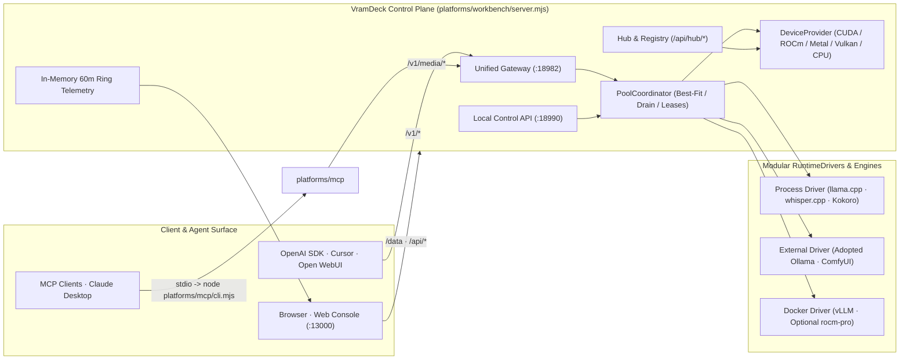

# System Architecture

[Documentation Index](../README.md) · [Runtime Topology](RUNTIME_TOPOLOGY.md) · [Engine Specification](ENGINES.md)

## Unified Single-Process Control Plane

VramDeck consolidates API routing, unified compute pool scheduling, hardware telemetry, Engine Hub operations, and the Next.js App Router Console inside **one Node.js (`>= 22.19`) control-plane process** (`platforms/workbench/server.mjs`), requiring zero external databases, message brokers, systemd units, or monitoring daemons out of the box.

## Key Subsystems

### 1. Hardware Discovery (`DeviceProvider`)
Probes available local accelerators across vendors without third-party native addons:
- **NVIDIA CUDA**: queries `nvidia-smi` for VRAM used/free/total, temperature, utilization, and wattage.
- **AMD ROCm**: queries `rocm-smi` (with platform/case-insensitive win32 shim support in `lib/devices/host.ts`).
- **Apple Silicon (Metal)**: queries `system_profiler` / unified memory metrics on `arm64` macOS.
- **Vulkan & CPU Standby**: detects Vulkan adapters or falls back seamlessly to host RAM and CPU inference when discrete GPUs are absent.

### 2. Unified Compute Pool (`PoolCoordinator`)
All discovered accelerators and host memory belong to **one unified local compute pool**. Rather than acting as a multi-node cluster manager, `PoolCoordinator` maintains real-time slot leases, reserved VRAM budgets, shared runtime coexistence (`shared` vs dedicated/atomic placement), graceful idle-drain before eviction, and fairness queues across concurrent API/MCP callers.

### 3. Capability-Driven Surface & `@vramdeck/engine-sdk` Isolation
Every engine package under `engines/*/*/engine.json` declares its resource requirements, supported compute backends (`cuda`, `rocm`, `metal`, `vulkan`, `cpu`), and `platform.surface` definitions (`group`, `task`, `sync` route, `category`). Gateway routing, MCP schemas (`platforms/mcp`), and Console cards are derived dynamically from manifests, and adapters import exclusively from `platforms/engine-sdk/` (`@vramdeck/engine-sdk`).

### 4. Built-in Engine & Model Hub (`lib/hub/`)
Replaces manual container and weight scripts with:
- Localhost service scanning (`Ollama`, `ComfyUI`, `llama-server`, `LM Studio`) and non-destructive HTTP adoption.
- Pool-aware quantization recommendations (`fits`, `tight`, `too_large`) checked against live free VRAM across the pool.
- Resumable HTTP Range `206` downloads with SHA256 verification from configurable mirrors (`huggingface`, `hf-mirror`, `modelscope`) or symlinked local directories.

### 5. Lightweight In-Process Telemetry
Sampling runs every 5 seconds into an in-memory 60-minute ring buffer (`platforms/workbench/lib/telemetry/`), driving `/data` and the live Console charts with zero mandatory Prometheus/Grafana stack.
