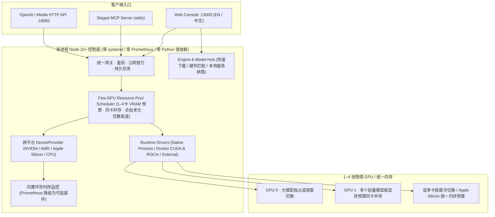

# 通用少 GPU 资源管理器升维方案与路线图

[文档目录](../README.md) · [项目现状](../guide/PROJECT_STATUS.md) · [当前运行模式](RUNTIME_TOPOLOGY.md) · [引擎目录](ENGINES.md)

更新：2026-11-22。本文记录将本项目从“单卡 AMD R9700 个人工作台”升维为**跨平台、多硬件、面向 1–4 卡用户的通用多模态 AI 资源管理器**的设计评审方案与分阶段路线图。

---

## 一、定位重塑与核心差异化

### 1.1 目标定位
> **Turn 1–4 GPUs into a unified multimodal AI workstation** — 围绕 **1–4 张消费级/工作站 GPU（或 Apple Silicon 统一内存）**，提供智能显存资源池调度、跨引擎按需切换与并存、统一 OpenAI/媒体 HTTP API、分级渐进式 MCP，以及零门槛快速下载中心，支持 Linux、Windows 与 macOS。

### 1.2 生态位对比
| 维度 | Ollama / LM Studio | llama-swap | GPUStack | 本项目（升维目标） |
|---|---|---|---|---|
| 硬件规模 | 单机单引擎 LLM | 单机 LLM 切换 | 多节点企业 GPU 集群 | **1–4 卡个人工作站 / HomeLab** |
| 多模态覆盖 | 仅 LLM / 视觉 | 仅 LLM | 偏企业级推理 | **LLM + 图像 + 视频 + 语音 + ComfyUI 统一编排** |
| 显存调度 | 简单 TTL 卸载 | 串行互斥切换 | 集群调度（重） | **多卡 VRAM 池 + 同卡小模型并存 + 合批老化防饥饿** |
| Agent / MCP | 无原生媒体 MCP | 无 | 无 | **分类渐进式 MCP + 持久任务 + 作品库 + 音色库** |
| 接入与部署 | 极简 | 较简 | 偏重 | **薄核单进程秒级启动 + 硬件感知快速下载中心** |

### 1.3 开源品牌与增长要素
- **项目命名候选**：`VramDeck` / `SlotGPU` / `GpuShelf` / `MuxGPU` / `FewGPU`（对外发布 v1.0 时统一仓库名并保留 GitHub 重定向）。
- **门面国际化**：英文主 `README.md` + 中文 `README.zh-CN.md`，控制台支持中英文切换。
- **首屏转化**：30 秒实拍演示 GIF（单/双卡上 MCP 驱动 LLM 与多模态自动腾挪显存 + 控制台实时显存拓扑条），配合“3 步 Quickstart”与硬件兼容矩阵。

---

## 二、五大核心架构支柱

### 2.1 控制面单栈收敛与渐进式 TypeScript
- **原生优先 + Docker 可选**：网关、调度器、设备探测、原生引擎驱动、内置遥测、Hub 下载器与 CLI 收敛到单进程 **Node.js 22.19+**，不再强依赖 Linux `systemd`、外部 `Prometheus` 容器或宿主机 `Python` 环境。
- **渐进式原生 TypeScript**：利用 Node 22 原生 Type Stripping（`erasableSyntaxOnly: true`，零构建转译层），新增核心模块与类型契约直接使用 `.ts`/`.tsx`；现有 `.mjs`/`.jsx` 模块随改造平滑迁移；模型内核、ComfyUI 节点及 ROCm 镜像配方继续保留在 Python 侧。
- **系统服务安装改为可选 CLI 能力**：支持按 OS 生成 `systemd --user`（Linux）、`launchd`（macOS）或计划任务（Windows）。

### 2.2 跨平台硬件探测层（`DeviceProvider`）与内置监控
- **标准化硬件视图**：统一输出主机内存与各 GPU 的 `vendor`、`backend`、`vram_total_mb`、`vram_used_mb`、`vram_free_mb`、`unified_memory`、`utilization_pct`、`temperature_c`、`power_w`。
- **分平台零重编译探测**：
  - **NVIDIA（Linux / Windows / WSL2）**：`nvidia-smi --query-gpu=... --format=csv,noheader,nounits`。
  - **AMD（Linux）**：保留零上下文只读 `/sys/class/drm/card*/device/*`（不唤醒 GPU），辅以 `rocm-smi` 兜底。
  - **AMD（Windows）**：PowerShell / `amd-smi` / Vulkan 枚举。
  - **Apple Silicon（macOS）**：`system_profiler SPDisplaysDataType -json` + `sysctl hw.memsize` + `vm_stat`（默认按系统内存 75% 计算可用统一内存预算）。
  - **无独显 / CI**：`cpu` / `mock` Provider，确保任意无卡环境与 CI 均可完整启动和验证调度逻辑。
- **内置 60 分钟环形时序缓冲**：控制面每 5 秒采样一次写入内存环形缓冲区，默认开箱即看 15/30/60 分钟曲线；若配置了外部 Prometheus，则可作为可选长周期后端接入。

### 2.3 1–4 卡 GPU 资源池调度器（`GpuPoolCoordinator`）
保留并扩展现有 [EngineScheduling](../../platforms/workbench/lib/engine-scheduling.mjs) 的合批与防饥饿等待语义，将全局单一租约升级为多卡资源池调度：
1. **引擎资源声明（`platform.resources`）**：声明支持的 `backends`（`cuda|rocm|metal|vulkan|cpu`）、`gpu_count`、`vram_mb`、`vram_mode`（`shared` 同卡并存 / `exclusive` 独占整卡）、`concurrency`、`affinity`（`any|prefer:<id>|pin:<id>`）与 `cold_start_weight`（`low|medium|high`）。
2. **四步放置与驱逐算法**：
   - **热命中**：目标运行时已加载且有并发余量，直接发放租约。
   - **同卡并存 / 空卡放置**：优先 Best-Fit 选择剩余显存满足 `vram_mb` 且无 `exclusive` 冲突的可用卡（或为多卡张量并行原子预留 `gpu_count` 张卡），保留整张大卡给重负载模型。
   - **优雅驱逐**：显存不足时按“空闲优先 → 满足合批老化条件 → `cold_start_weight` 最低”选择受害者，双检空闲后卸载。
   - **单卡完全退化**：1 张卡且模型声明为 `exclusive` 时，调度行为与现有单卡合批老化队列 100% 等价。
3. **清理 LLM 抽象泄漏**：将通用调度器与后端基座中残留的特定容器名、端口、策略槽位收口到引擎适配器钩子与 `engine-sdk`。

### 2.4 可插拔运行时驱动（`RuntimeDriver`）
- **`process`（原生优先）**：跨平台 `spawn` 管理本地进程（`llama-server`、`whisper-server`、本地 `ComfyUI`、`mlx-lm` 等），捕获 stdout/stderr 环形日志，按分配结果注入 `CUDA_VISIBLE_DEVICES` / `HIP_VISIBLE_DEVICES` / `ROCR_VISIBLE_DEVICES` / `GGML_VK_VISIBLE_DEVICES`。
- **`docker`（可选容器）**：通用容器生命周期，按目标卡自动注入 NVIDIA `--gpus` 或 AMD `/dev/kfd` + `/dev/dri` 与设备隔离环境变量。
- **`external`（纳管已有服务）**：零启动成本接入本机已运行的 Ollama、LM Studio 或远程 ComfyUI，统一提供网关队列准入、鉴权、MCP 暴露与记录追踪。

### 2.5 薄核 + 快速下载中心（不预装、零门槛引导）
- **零捆绑瘦身**：仓库与控制面安装包不内置权重与推理二进制；存储路径按 OS 自动生成默认目录（保留外置作品盘 `marker` 离线保护作为可选配置）。
- **Engine & Model Hub**：
  - **已有服务自动扫描纳管**：发现本机 Ollama / ComfyUI / llama-server 一键接入。
  - **引擎一键下载**：依据探测到的 OS + GPU 架构自动匹配预编译包或 Docker 镜像，支持进度、断点续传与 SHA256 校验。
  - **模型快速下载入口**：按实测显存标注推荐量化，支持 HuggingFace / HF-Mirror / ModelScope 一键下载或关联已有本地目录。
  - **通用主流目录 + 高级硬件包**：内置轻量适配器清单覆盖 `llama.cpp`、`Ollama`、`ComfyUI`、`whisper.cpp`、`Kokoro`/`Fish-Speech`、`vLLM`；现有 AMD R9700 / Paiton 全套引擎作为官方 `ROCm Pro Pack` 完整保留。

---

## 三、现有模块改造映射

| 现有模块 | 当前局限 | 目标演进方向 |
|---|---|---|
| [platforms/platform.json](../../platforms/platform.json) / [storage.mjs](../../platforms/workbench/lib/storage.mjs) | 含本机绝对路径与单一外置盘假定 | 跨平台 OS 默认目录 + `"auto"` 解析 + 可选配置覆写，保留 marker 防误写 |
| [platforms/workbench/lib/core.mjs](../../platforms/workbench/lib/core.mjs) | 单卡全局锁 + 内联 LLM 策略切换 | `GpuPoolCoordinator`（多卡 slot、VRAM 预算、并存、驱逐）+ 通用策略钩子 |
| [platforms/workbench/lib/backend.mjs](../../platforms/workbench/lib/backend.mjs) | 耦合 `./lab`、Docker、`sysfs`、`paiton-qwen38` | 拆分为 `drivers/`（`process`/`docker`/`external`）+ `devices/`（多厂商探测） |
| [platforms/workbench/lib/monitoring.mjs](../../platforms/workbench/lib/monitoring.mjs) | 强依赖 Prometheus 与 AMD exporter | 内置 `telemetry.mjs`/`.ts` 内存环形采样为默认源；Prometheus 转为可选 |
| [platforms/workbench/lib/registry.mjs](../../platforms/workbench/lib/registry.mjs) | **已实现 `platform.surface` 自描述** | 扩展校验 `platform.resources` 与 `runtime.driver`，对接 Hub 目录 |
| [platforms/workbench/cli.mjs](../../platforms/workbench/cli.mjs) / [.workbench/cli.py](../../.workbench/cli.py) | 强绑定 Linux `systemd` 与 Python 入口 | 收敛为跨平台 Node CLI；ROCm 构建器保留为高级扩展工具 |
| [platforms/workbench/app/](../../platforms/workbench/app/page.jsx) | 中文单语、硬编码型号名、压缩行风 | 中英双语 i18n、多卡显存拓扑条、Engine & Model Hub 下载页、Prettier 规范化 |

---

## 四、分阶段实施路线图

| 阶段 | 范围与核心交付物 | 验收门槛 |
|---|---|---|
| **Phase 0：工程地基与跨平台解耦** | 设计文档、Prettier + `tsconfig.types.json`（Phase 1 锁定 `typescript` 与 `@types/*` 后升级为 `tsconfig.json`）+ `lib/types.ts`、三平台 GitHub Actions CI、Python 跨平台/洁净仓库测试全绿、修复前端渲染副作用与硬编码设备名、封堵适配器 SDK 泄漏 | Windows / macOS / Linux 下 Python 套件全部通过；无硬编码本机设备名；模块依赖保持 0 循环 |
| **Phase 1：硬件层 + 多卡池 + 原生驱动** | `DeviceProvider`（NV / AMD / Apple / CPU）、内置 60 分钟环形监控、`GpuPoolCoordinator`（1–4 卡放置/并存/驱逐）、`process`/`docker`/`external` 三类驱动、跨平台 Node CLI | 单卡兼容回归全部通过；2–4 卡异构与同卡并存模拟调度矩阵测试通过；三系统实机探卡通过 |
| **Phase 2：Hub 快速下载中心 + 主流引擎 + 双语 UI（v1.0）** | `llama.cpp` / `Ollama` / 通用 `ComfyUI` / `whisper.cpp` / TTS 适配器与快速下载器（HF/HF-Mirror/ModelScope）、`ROCm Pro Pack` 分组、多卡显存拓扑视图、EN/ZH 切换、Linux/macOS/Windows 一键安装脚本 | 新用户在无预装引擎机器上 3 分钟完成安装、下载/纳管 1 个对话与 1 个媒体模型，并可在 MCP 客户端完成自动切换调度 |
| **Phase 3：开源破圈与社区治理** | 英文主 README + 30 秒首屏实拍 GIF、`CONTRIBUTING.md` 与“20 分钟接入新引擎”教程、Issue/PR 模板与 `good first issue`；`r/LocalLLaMA` / `Show HN` / 中文社区发布 | 形成完整外宣物料与低门槛贡献路径 |
| **Phase 4：进阶能力深化（v1.1+）** | 可插拔 CPU 权重驻留（sleep/wake）、第三方引擎插件源（Remote Registry）、可选轻量桌面托盘包装 | 跨模型热唤醒降为秒级，支持社区一键导入引擎包 |
